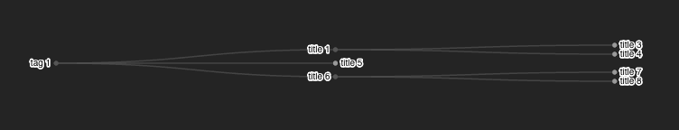

# Sample Tree Diagram with D3.js in React

This project demonstrates how to create a tree diagram using D3.js within a React application. The tree structure is defined in TypeScript, and the visualization is rendered using SVG elements.



## Run

```sh
npm run dev
```

## References

- [D3.js Tree Diagram](https://observablehq.com/@d3/tree/2)
- [Example with TypeScript](https://javascript.plainenglish.io/a-brief-guide-to-typescript-and-d3js-hierarchy-and-trees-f9bb45871d88)
